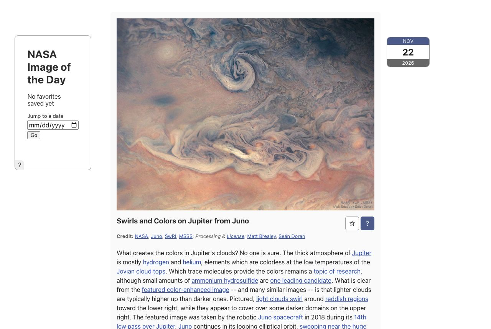
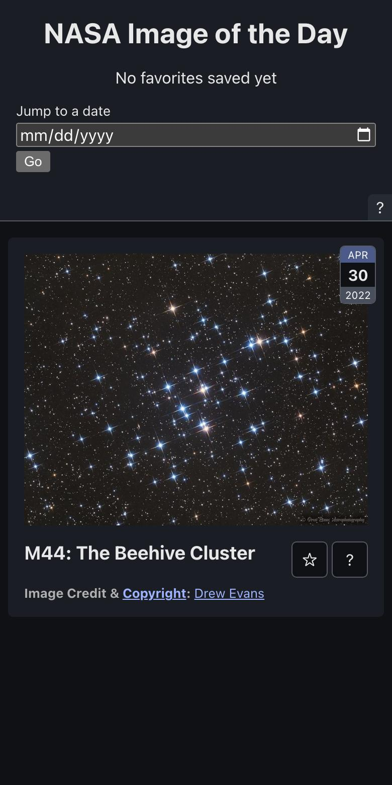

# NASA Image of the Day

An infinite-scrolling feed of NASA's [Astronomy Picture of the Day](https://science.nasa.gov/apod/), built as a **textbook example of current React**. Every file is commented like a tutorial, and the git history is a sequence of chapters you can check out one at a time.

**[Live demo](https://lucidbeaming.github.io/nasa-iod/)** · **[Tutorial](docs/TUTORIAL.md)** · [Conventions](docs/CONVENTIONS.md) · [Stack](docs/STACK.md)





## What it does

- Scrolls back through every APOD since June 16, 1995, 25 at a time, and stops at the first one.
- Shows pictures (responsive and lazy-loaded), videos (loaded only when you press Play) and anything else as a link.
- Keeps favorites in your browser, in sync across tabs. Favorites saved by the 2021 version are migrated.
- Gives every day a permalink (`/day/2022-04-30`), with its own page title and description.
- Jumps to any date, and tells you when a day has no picture.
- Works with a keyboard and screen reader, follows your light/dark setting, and respects reduced motion.

## How to read this code

Start with **[docs/TUTORIAL.md](docs/TUTORIAL.md)**. It has three reading paths: chapter by chapter, by concept (an index of every 📘 Concept and ⚠️ Common mistake), or the finished app from `src/main.tsx` down.

Each chapter is one issue, one pull request and one tag:

```bash
git checkout chapter-05   # the app as it was after chapter 05
npm install
npm run dev
```

The starting point is tag [`v0-2021`](https://github.com/lucidbeaming/nasa-iod/tree/v0-2021), the original 2021 Create React App version. Its bugs (#8–#12) were fixed along the way, and the ⚠️ comments quote it.

## Stack

|                 |                                                                                                 |
| --------------- | ----------------------------------------------------------------------------------------------- |
| Build           | [Vite](https://vite.dev) 8                                                                      |
| UI              | [React](https://react.dev) 19 with the [React Compiler](https://react.dev/learn/react-compiler) |
| Language        | [TypeScript](https://www.typescriptlang.org) 7, strict                                          |
| Server state    | [TanStack Query](https://tanstack.com/query) 5                                                  |
| Validation      | [Zod](https://zod.dev) 4                                                                        |
| Routing         | [React Router](https://reactrouter.com) 8, declarative mode                                     |
| Errors          | [react-error-boundary](https://github.com/bvaughn/react-error-boundary)                         |
| Styling         | CSS Modules and design tokens, no CSS library                                                   |
| Lint and format | [oxlint](https://oxc.rs) (with the React Compiler's rules) and Prettier                         |

[docs/STACK.md](docs/STACK.md) explains each choice: why it's used, the plain-React alternative, and when you wouldn't need it. Tests are out of scope for this version; STACK.md says where they'd go.

## Run it

Requires Node 22.22 or newer. No API key is needed.

```bash
git clone https://github.com/lucidbeaming/nasa-iod.git
cd nasa-iod
npm install
npm run dev        # http://localhost:5173
```

| Script                            |                                                                              |
| --------------------------------- | ---------------------------------------------------------------------------- |
| `npm run dev`                     | dev server with Fast Refresh                                                 |
| `npm run build`                   | type-check (`tsc -b`) and build to `dist/`                                   |
| `npm run preview`                 | serve the build locally                                                      |
| `npm run lint`                    | oxlint                                                                       |
| `npm run format` / `format:check` | Prettier                                                                     |
| `npm run deploy`                  | build and publish `dist/` to GitHub Pages (`gh-pages` branch)                |
| `npm run build:site`              | build the copy served at joshuacurry.dev/react/nasa-iod to `dist-site/`      |
| `npm run package:site`            | `build:site`, then zip `dist-site/` with a SHA-256 checksum, for the release |

`build:site` is the same app with the base path `/react/nasa-iod/`. It skips the GitHub Pages `404.html` copy, since joshuacurry.dev answers deep links itself, and adds a canonical URL and Open Graph tags for link previews (see `vite.config.ts`). Each release attaches its `nasa-iod-site-<version>.zip`, and the site deploys that file, never building the app itself.

## Data and credits

Pictures, explanations and credits come from NASA's [APOD Basic API](https://api.nasa.gov/assets/files/apod/APOD-APIs-and-RSS-info.pdf) (`science.nasa.gov/wp-json/wp/v2/apod-basic`). The Astronomy Picture of the Day is written and edited by Robert Nemiroff and Jerry Bonnell. Each picture is credited to its creators in the app, and many are copyrighted by them.

The 2021 version used `api.nasa.gov/planetary/apod`, which has returned placeholder data since APOD moved to science.nasa.gov (#8).

This project is not affiliated with NASA.

## License

[MIT](LICENSE). Release 1.0.0 was published under GPL-3.0, and those copies keep that license. The license covers this code, not the APOD images and text, which belong to their credited owners.
